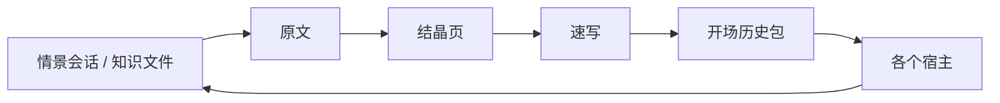

<p align="center">
  
</p>

<p align="center">
  私人记忆中枢<br>
  <em>One private memory, for every agent you already run.</em>
</p>

<p align="center">
  <a href="#它解决什么">它解决什么</a>
  ·
  <a href="#一次会话怎么用记忆">一次会话怎么用记忆</a>
  ·
  <a href="#记忆长什么样">记忆长什么样</a>
  ·
  <a href="#从原文到结晶">从原文到结晶</a>
  ·
  <a href="#已经接上的宿主">宿主</a>
  ·
  <a href="#在自己的机器上跑起来">跑起来</a>
</p>

ROGMEM 是可在极空间 NAS 或私人服务器部署的私人记忆中枢，可通过 MCP 为用户在不同设备上的不同 Agent 提供一站式记忆和知识管理服务，致力于解决跨设备、跨 Agent 工作时的记忆、知识和技能孤岛问题。

你在 Cursor 里说定的偏好和约定，下一场换到 Hermes、Codex 或另一台电脑，开场就能用上。记忆留在你自己的服务器里。各个窗口不再各记一份。

| | |
| --- | --- |
| **开场只带够用的** | 人物速写、这场的工程速写，以及字数以内的最近摘录 |
| **模型判断，程序验收** | 引文必须是连续原文。对不上，这一节就不发布 |
| **数据在你这边** | 服务跑在你的 NAS 或服务器上。导入历史、停止授权、删除，都先问你 |

## 它解决什么

一个人会同时用好几个智能体，也会换电脑。上一场说定的称呼、禁忌、仓库里不能动的约定，若只留在那个窗口里，下一场就得重新讲。

ROGMEM 把两样东西收成同一份记忆：

- **情景会话。** 各宿主交上来的用户原话，和你看得见的回复。
- **知识文件。** 你指定目录里的 txt、md、markdown、pdf、docx、pptx、xlsx、xls、csv。相同内容只留一条。

开场装入有字数上限，默认 15000 字，在基础设置里改。已经打开的会话沿用它开场时的那一包。

**现状。** 会话、知识文件、结晶页、跨宿主装入，已经在用。技能的发现和同步还没有做成单独的功能。上面那句「技能孤岛」说的是要解决的问题。

## 一次会话怎么用记忆

新会话先取一份历史包，读完再答。一份历史包里，按这个顺序：

1. **人物速写。** 记忆主人是谁、怎么称呼，以及最近摘录覆盖不到、省掉就会让下一手做错的事。
2. **工程速写。** 这场对上了已有的工程页时才有。写这个仓库不能改的约定，和做到哪一步。
3. **最近摘录。** 字数还剩多少，就放多近的原文。装不下时，包里会给出续读位置。

这一问要的事实不在包里，再检索。要看某一节的正文、这一节先后为什么改、或回到某条原文，再往下读。你本场刚说的话，优先于历史包。

通道暂时连不上时，这一场照宿主自己的上下文继续。没送出的回合留在本机，接通后续传。



## 记忆长什么样

一份材料里，离开它以后还会单独被找的主体，各自成一页。页有五类。

| 类型 | 单独成页的时候 |
| --- | --- |
| 人物 | 还会被单独用到的人。记忆主人本人的篇名是「记忆主人」 |
| 工程 | 有自己的仓库地址、以后还会单独打开的工作 |
| 组织 | 还会继续存在的集体 |
| 产品 | 已经有名字、被人拿来用的产物 |
| 概念 | 换一份材料仍然成立的想法、方法或规矩 |

每一页有正文和速写。速写是下一场会直接装进历史包的那一层。正文留着依据。页与页之间还在生效的关系，画在记忆图谱上。鼠标停在一颗星点上，它会换成主题色。单击后，直接相连的星点和连线也换成主题色；再点空白处，颜色回到原来的样子。双击才打开那一篇。右上角写着库里现在有多少个活跃节点。

一页为什么变成现在这样，有修订可查。某一节里先后两种说法，也能顺着修改理由看下来。

## 从原文到结晶

原文进来以后，走同一条管线：解析、草稿、并页、速写。向量化在旁边进行。

模型负责看懂眼前这份材料。程序负责验收形状：引文是不是连续原文，交卷的结论合不合法。判断标准写成能用到下一份材料上的启发式。程序不靠一份专名清单去决定谁该成页。

| 工人 | 它判断的事 |
| --- | --- |
| 初始蒸馏 | 这份材料里，谁值得单独写一页。草稿、并页和速写都用它 |
| 身份合并 | 两篇是不是同一个主体。是，才收成一篇；另一种叫法留在别名里 |
| 向量嵌入 | 把材料写成向量，供检索 |

没单独指定模型时，身份合并沿用初始蒸馏。说法对不上，在并页里裁决，不另开一个工人。送去蒸馏的原文里，密钥模样的字符串会先换成占位。

要改已经发布的一页，智能体交一页同样形状的草稿。篇名必须对上现有的页。正在用的正文和速写保持不动，直到这页草稿走完并页和速写。

## 已经接上的宿主

| 宿主 | 接入方式 |
| --- | --- |
| Cursor、Trae、Hermes、Codex、WorkBuddy、CodeBuddy | 同一份 hook |
| DSH | 插件 |

宿主管理列出所有设备上的宿主。列表不单列设备名，筛选仍按设备。当前这台电脑只在显示名后面加「（本机）」，这个字不写进设备名。

每个程序领各自的钥匙。已经启用的不重发。停用之后可以再通过，沿用原来的钥匙。添加宿主时，服务器签发一张短时凭证；贴给这台电脑上任意一个已安装的宿主，它会把这台电脑上已安装的宿主一起接上。

待导入会话数是本机已经扫到、还没进入中枢的条数。你确认之后才导入。

管理台还有情景会话、知识文件、结晶记忆、记忆图谱、监控中心和系统设置。监控中心在系统设置前面，里面是成本明细、队列状态和运行日志。成本明细按每次调用的 token 和当前单价折算金额；单价按模型记，改了以后会重算已经发生的调用。系统设置里是基础设置、宿主管理、模型管理、管线设置和关于。停止授权和删除都会先弹出确认，只有点确认才会发出请求。

## 在自己的机器上跑起来

服务和网页管理台在同一个镜像里。镜像监听 **18080**。数据在 `/data`，扫描目录在 `/scan`。

在仓库根目录：

```bash
docker build -t rogmem .
docker run -d --name rogmem \
  -p 18080:18080 \
  -v rogmem-data:/data \
  -v rogmem-scan:/scan \
  rogmem
```

第一次构建会准备中文向量模型。启动后打开 <http://127.0.0.1:18080> 。

```bash
curl -s http://127.0.0.1:18080/healthz
```

返回里的 `service` 是 `rogmem`，`version` 与关于页相同。管理台和记忆服务在同一个端口。能访问这个地址的人就能打开管理台；智能体调用 `/mcp` 仍要各自的钥匙。把 18080 留在你信任的网络里。

然后做三件事：

1. 在模型管理里登记对话模型和向量模型，到管线设置里分给上面的工人。
2. 把要入库的文件放进扫描卷。容器里这条路径是 `/scan`。
3. 在系统设置的宿主管理里点「添加宿主」，把签发的提示贴给这台电脑上已经安装的智能体。

本机命令用 **Python 3.12 或更高**。仓库里直接在根目录执行。还没有这份代码的电脑不克隆 GitHub：添加宿主的提示带着你打开这一页时的入口，和这份中枢的身份。入口以后变了，本机门口仍接到同一个身份。本机用这个入口的 `/host-bootstrap` 把命令装进 Python；入口当时打不开、门口已经是这个身份时，从门口装。再由本机的 `18780` 接到这个中枢。`python -m rogmem` 在服务器镜像里就是服务本身；在你的电脑上，它只做通道、接入和历史上传，记忆仍只在服务器上。

能直接访问服务器时，`python -m rogmem channel --origin <入口>` 把本机 `18780` 交给这次登录保持，宿主仍写 `http://127.0.0.1:18780/mcp`。入口是当时能打开的地址；身份相同的另一扇门，程序会自己接上。地址还要浏览器会话时，先在本机保持：

```bash
python3.12 -m rogmem channel
```

它把已经打开的远程访问转到 `http://127.0.0.1:18780/mcp`。

## 智能体怎么调用

调用 `/mcp` 要带这把宿主的钥匙。

| 工具 | 什么时候用 |
| --- | --- |
| `core` | 开场装入历史包。这一场已经成功取过，就等包里给出续读位置再取更早的摘录 |
| `search` | 这一问的事实不在历史包里 |
| `read_section` | 读某一页正文里的一节 |
| `read_chain` | 看这一节先后怎么变、每次为什么改 |
| `read_source` | 按来源编号读原文 |
| `read_revisions` | 看整页为什么变成现在这样 |
| `submit_turn` | 提交用户原话，或你看得见的回复 |
| `pending_host_import_jobs` | 认领属于自己这台电脑这个宿主的历史导入作业 |
| `ack_host_import_job` | 作业完成或失败后，回传给中枢的计数（只写计数、不写正文） |
| `renew_host_import_lease` | 分批上传期间续租，防止长作业因 lease 过期被服务器拒绝 |
| `announce_capabilities` | 客户端上报自身能力；没有这一步就当成老版本，不会收到新作业 |
| `submit_draft` | 提交修改已有一页的草稿 |
| `guide` | 读取这份记忆怎么用 |

## 版本与联系

关于页和 `/healthz` 使用同一套版本号。打包后的正式环境是 `V1-` 加 10 位打包时间再加后缀：私有仓库 `rogmem-dev` 盖 `-DEV`，公开仓库 `rogmem` 才盖 `-PUB`。预发布是同一打包时间加 `-PRE`。没有经过打包的运行显示 `V1-未打包`。

代码在 [`rogmem/`](rogmem/)。给在这个仓库里工作的智能体的约定在 [`AGENTS.md`](AGENTS.md)。哪些文档已经过期，看 [`docs/CURRENT.md`](docs/CURRENT.md)。

- GitHub：<https://github.com/rogdance/rogmem>
